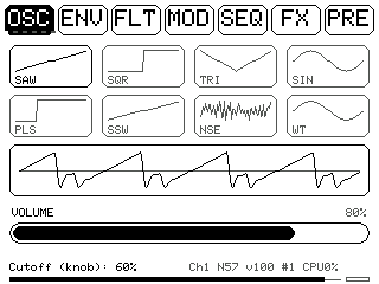
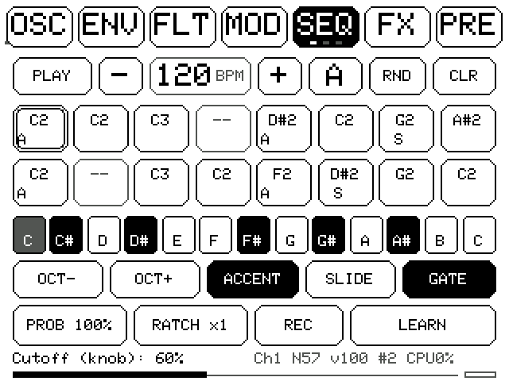
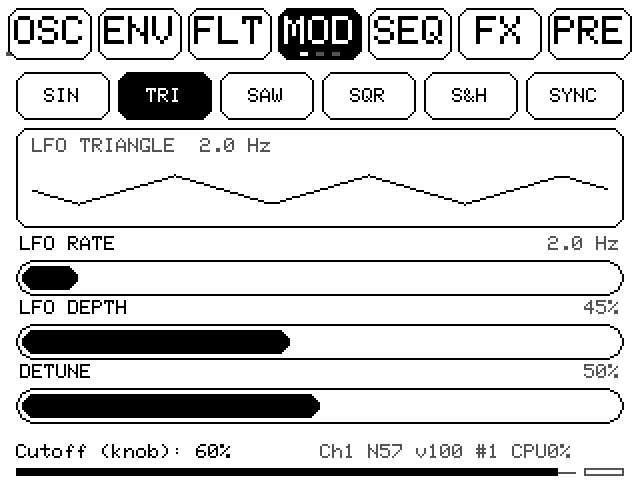
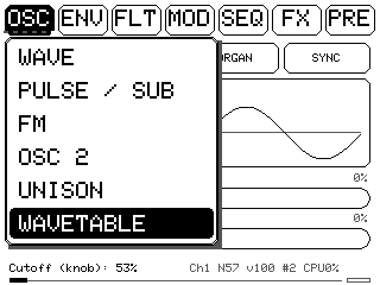
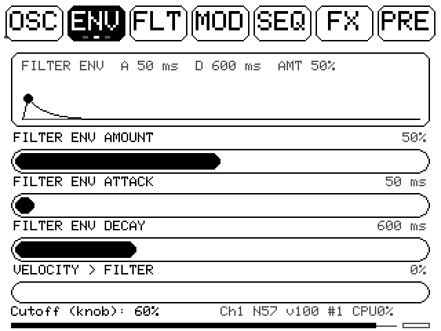
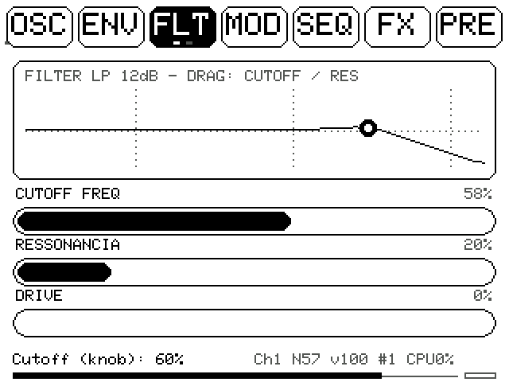
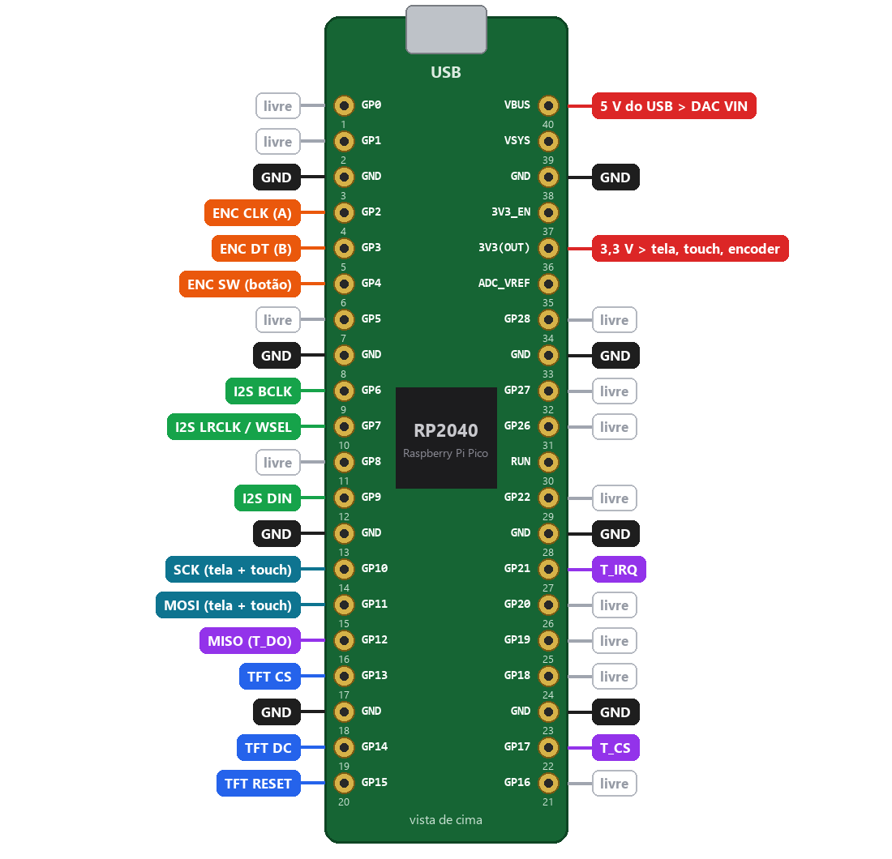

# Tobri Synth (RP2040)

Sintetizador polifônico de 4 vozes num Raspberry Pi Pico (RP2040). Tem tela touch de 3,2" (ILI9341 + XPT2046), DAC I2S UDA1334A, encoder e USB MIDI. Também tem uma caixa no formato Eurorack para imprimir em 3D.

<p align="center">
  
  
  
</p>
<p align="center">
  
  
  
</p>

> As telas acima foram geradas pelo próprio firmware, compilado no PC com o emulador de [`tools/emu`](tools/emu).

## Recursos

- **Som:** 4 vozes (POLY / MONO / LEGATO com glide). Áudio a 32 kHz, todo em ponto fixo.
  - **Osciladores:** SAW, SQR, TRI, SIN, PULSE, SUPERSAW, ruído e **wavetable** (4 bancos × 8 quadros, com morph).
  - **Também:** OSC2 com hard sync e ring mod, sub-oscilador, FM com feedback e unison até ×5.
- **Filtro:** LP, BP ou HP, de 12 ou 24 dB. Tem drive, wavefolder, envelope próprio e velocity.
- **Modulação:**
  - LFO com 5 formas (SIN, TRI, SAW, SQR, S&H), que pode seguir o BPM;
  - envelope de pitch;
  - matriz 4×4 (fontes LFO, F.ENV, A.ENV e VEL; destinos CUTOFF, PITCH, PWM/WT e VOLUME).
- **Sequenciador:**
  - 16 passos, 4 padrões, chain;
  - accent 303, slide, probabilidade e ratchet;
  - swing, direções, live rec;
  - sync por MIDI clock;
  - UNDO.
- **Efeitos:** bitcrusher, chorus, delay ping-pong e reverb.
- **Presets e MIDI:** 8 presets com nome. CC learn, Program Change e pads de controlador como passos do sequenciador.
- **Interface:**
  - 7 abas; tocar na aba aberta mostra o menu com o nome de cada página;
  - toque filtrado, ajuste FINE e toque duplo para voltar ao valor padrão;
  - swipe entre páginas;
  - calibração do touch e medidor de saída com CLIP.
- **Encoder:**
  - girar muda o cutoff;
  - segurar e girar muda a ressonância;
  - um clique dá PLAY/STOP;
  - segurar parado aciona o pânico.

## Documentação

| | |
|---|---|
| [docs/Tobri_Synth_Manual.pdf](docs/Tobri_Synth_Manual.pdf) | Manual de uso ilustrado, página por página |
| [docs/Tobri_Synth_Ligacoes.pdf](docs/Tobri_Synth_Ligacoes.pdf) | Esquema de ligação no Pico, fio a fio |

## Ligação

<p align="center"></p>

| Módulo | Pinos do Pico |
|---|---|
| Display ILI9341 (SPI1) | GP10 SCK, GP11 MOSI, GP13 CS, GP14 DC, GP15 RESET, VCC e LED no 3V3 |
| Touch XPT2046 | GP10 T_CLK, GP11 T_DIN, GP12 T_DO, GP17 T_CS, GP21 T_IRQ |
| DAC UDA1334A (I2S) | GP6 BCLK, GP7 WSEL/LRCLK, GP9 DIN, VIN no VBUS (5 V) |
| Encoder | GP2 CLK/A, GP3 DT/B, GP4 SW, comum no GND |

O SDO (MISO) da tela fica desligado. O LRCLK precisa estar no pino seguinte ao BCLK. Os detalhes estão no PDF de ligação.

## Compilar e gravar

1. Instale o Arduino IDE e o core **Raspberry Pi Pico/RP2040/RP2350** (Earle Philhower).
2. Instale as bibliotecas pelo gerenciador: **Adafruit GFX**, **Adafruit ILI9341**, **XPT2046_Touchscreen** e **MIDI Library**. O Adafruit TinyUSB já vem com o core.
3. Abra `firmware/tobri_synth_firmware_touchscreen_5/tobri_synth_firmware_touchscreen_5.ino`.
4. Em **Ferramentas**, escolha:
   - **Placa:** Raspberry Pi Pico
   - **USB Stack:** Adafruit TinyUSB (obrigatório para o USB MIDI)
5. Grave. O synth aparece no computador como o dispositivo MIDI **"RP2040 Synth"**.

Pela linha de comando:

```
arduino-cli compile --fqbn "rp2040:rp2040:rpipico:usbstack=tinyusb" firmware/tobri_synth_firmware_touchscreen_5
```

## Caixa (Eurorack 3U, 20 HP)

Modelos OpenSCAD paramétricos em [`case/`](case), com os STLs prontos em [`case/stl/`](case/stl):

- `tobri_eurorack.scad`: painel, prateleira da Pico/DAC e knob (escolha a peça no Customizer);
- `tobri_painel_knob.scad`: só o painel e o knob, já posicionados na mesa da Ender 3 V2.

Impresso em PLA, o painel fica com a frente virada para a mesa e não precisa de suporte.

## Ferramentas

[`tools/`](tools) tem o emulador da interface, que roda o código de desenho do firmware no PC, e os scripts que geram os PDFs. Veja [`tools/README.md`](tools/README.md).

## Estrutura

```
firmware/   sketch Arduino
case/       caixa Eurorack (OpenSCAD + STL)
docs/       manual, esquema de ligação e imagens
tools/      emulador da tela e geradores dos PDFs
```

## Licença

[MIT](LICENSE): pode usar, modificar e distribuir, inclusive comercialmente, mantendo o aviso de copyright.
